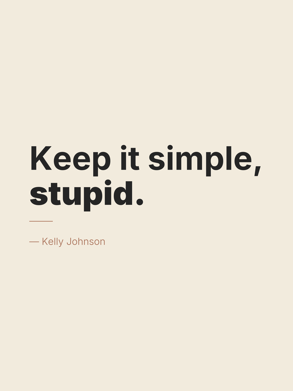

# LocalImageAI

Makes print-ready typography posters (18×24 in, 5400×7200 px, 300 dpi) on your Mac.

Your quote and author are drawn by Python (Pillow), so they always come out spelled exactly as you typed them. You can add an AI-generated background from the [Draw Things](https://drawthings.ai) app.



## Setup

You need Python 3.10 or newer.

```sh
cd LocalImageAI
python3 -m venv .venv
.venv/bin/pip install -r requirements.txt
```

The Inter fonts are already included in `fonts/`.

## Make a poster

```sh
.venv/bin/python main.py --quote "Keep it simple,\nstupid." --author "Kelly Johnson" --emphasis-last
```

The finished poster is saved in `outputs/posters/`.

- Type `\n` in the quote wherever you want a new line.
- The quote is sized automatically to fill the poster's width.
- The text is drawn exactly as you type it, so add your own quotation marks if you want them.

### Options

| Option | Default | What it does |
| --- | --- | --- |
| `--quote` | *(required)* | The quote text. |
| `--author` | none | Shown as "— Author" under the quote. |
| `--bg` | `#F2EBDD` (cream) | Background colour. |
| `--text-color` | `#252525` (charcoal) | Quote colour. |
| `--author-color` | `#A66B52` (terracotta) | Colour of the author and the thin accent line. |
| `--emphasis-last` | off | Sets the last line of the quote in a heavier weight. |
| `--bg-prompt` | none | Generates the background with Draw Things (see below). |

Run `.venv/bin/python main.py --help` to see the same list in your terminal.

### Example: different colours

```sh
.venv/bin/python main.py \
  --quote "Less,\nbut better." --author "Dieter Rams" \
  --bg "#1E2A38" --text-color "#F4F1EA" --author-color "#D9A441"
```

## AI backgrounds (optional)

1. Open Draw Things and choose a model.
2. Enable its HTTP API server on port **7860**.
3. Describe the scene with `--bg-prompt`. Don't include your quote or any text in the prompt; the script already asks the model to leave text out.

```sh
.venv/bin/python main.py \
  --quote "Stay curious." --author "Unknown" \
  --bg-prompt "misty mountain lake at dawn, soft light, minimal" \
  --text-color "#FFFFFF" --author-color "#FFFFFF"
```

The text colour doesn't adjust to the background, so pick colours that stand out from the image.

The raw AI image is saved to `outputs/generated/`, and the finished poster to `outputs/posters/`.

## Generate a plain image (no poster)

To make an image without any text:

```sh
.venv/bin/python image_generator.py
```

Paste your prompt, then press **Ctrl-D** on an empty line. You can also read the prompt from a file: `.venv/bin/python image_generator.py < prompt.txt`.

To choose the size, pass both `--width` and `--height`, as multiples of 64:

```sh
.venv/bin/python image_generator.py --width 832 --height 1248   # 2:3 portrait
```

If you leave them out, the size comes from the Draw Things app.

## Test

```sh
.venv/bin/python test_poster_maker.py   # prints "ok"
```
